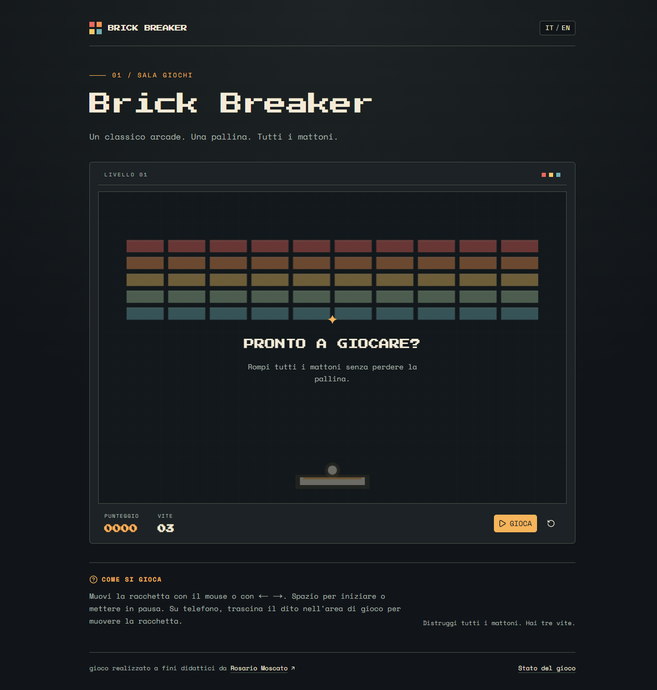

# Brick Breaker



Un piccolo gioco arcade ispirato a Breakout: muovi la racchetta, rompi tutti i mattoni e cerca di non esaurire le tre vite. È giocabile da desktop e telefono, in italiano e inglese. Il punteggio resta solo nella memoria del browser: non servono account né database.

## Stack

Next.js (App Router), React, TypeScript, Tailwind CSS e shadcn/ui. La fisica del gioco è in `src/lib/game.ts`; il campo viene disegnato su Canvas, mentre i testi bilingui sono in `src/lib/i18n.ts`. Lo stile è descritto in `DESIGN.md`.

## Avvio locale

```bash
npm install
npm run dev
```

Apri [http://localhost:3000](http://localhost:3000). Se la porta è occupata, usa `npm run dev -- -p 38743` e apri `http://localhost:38743`. Mouse o frecce ← → muovono la racchetta; la barra spaziatrice avvia o mette in pausa. Su telefono trascina il dito sul campo. Per verificare il progetto: `npm run test`, `npm run lint`, `npm run build`.

Quando sarà pubblicato, `APP_URL` dovrà contenere l'indirizzo pubblico per sitemap e anteprime dei link.
